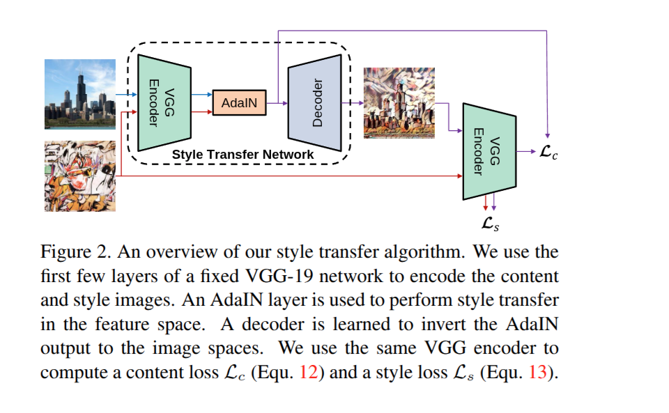

🎨 Arbitrary Neural Style Transfer (AdaIN)

Transform any image into a masterpiece in real-time using Deep Learning.

Features • Architecture • Installation • Usage • Gallery

📖 Overview

This repository features an end-to-end Deep Learning pipeline for Arbitrary Neural Style Transfer. Unlike standard style transfer models trained on a single painting, this project utilizes Adaptive Instance Normalization (AdaIN) to blend any content image with any style image instantly, without needing to retrain the network.

The project includes everything from custom dataset training scripts and exploratory notebooks to a fully functional, deployable web application.

✨ Features

⚡ Real-Time Arbitrary Stylization: Apply any style to any image in a single forward pass.

🌐 Interactive Web Interface: A user-friendly web app (served via app.py and templates/) to easily upload images and generate art.

🧠 Custom Training Pipeline: Train your own encoder-decoder network from scratch using train.py.

☁️ Cloud Ready: Pre-configured with a Procfile.txt for seamless deployment to cloud platforms like Heroku or Render.

🏗️ Architecture

The model is built on the AdaIN architecture, which aligns the channel-wise mean and variance of the content feature maps to match those of the style feature maps.

<div align="center">

# 🎨 Arbitrary Neural Style Transfer (AdaIN)

**Transform any image into a masterpiece in real-time using Deep Learning.**

[Features](#-features) • [Architecture](#%EF%B8%8F-architecture) • [Installation](#%E2%9A%99%EF%B8%8F-installation) • [Usage](#-usage) • [Gallery](#%EF%B8%8F-gallery)

</div>

## 📖 Overview
This repository features an end-to-end Deep Learning pipeline for Arbitrary Neural Style Transfer. Unlike standard style transfer models trained on a single painting, this project utilizes **Adaptive Instance Normalization (AdaIN)** to blend any content image with any style image instantly, without needing to retrain the network.

The project includes everything from custom dataset training scripts and exploratory notebooks to a fully functional, deployable web application.

## ✨ Features
- **⚡ Real-Time Arbitrary Stylization:** Apply any style to any image in a single forward pass.
- **🌐 Interactive Web Interface:** A user-friendly web app (served via `app.py` and `templates/`) to easily upload images and generate art.
- **🧠 Custom Training Pipeline:** Train your own encoder-decoder network from scratch using `train.py`.
- **☁️ Cloud Ready:** Pre-configured with a `Procfile.txt` for seamless deployment to cloud platforms like Heroku or Render.

## 🏗️ Architecture
The model is built on the AdaIN architecture, which aligns the channel-wise mean and variance of the content feature maps to match those of the style feature maps.



## 📂 Repository Structure
```text
📦 ai-nst-project
 ┣ 📂 Demo_IO_Images     # Sample content, style, and generated output images
 ┣ 📂 content_data       # Training dataset directory for content images
 ┣ 📂 style_data         # Training dataset directory for style images
 ┣ 📂 templates          # HTML files for the web application UI
 ┣ 📂 uploads            # Temp storage for user-uploaded images during inference
 ┣ 📂 utils              # Helper functions (preprocessing, loss functions, etc.)
 ┣ 📜 Procfile.txt       # Deployment configuration file
 ┣ 📜 README.md          # Project documentation
 ┣ 📜 adain_algo.png     # Architecture diagram
 ┣ 📜 app.py             # Main web application and inference script
 ┣ 📜 code.ipynb         # Jupyter Notebook with EDA and experiments
 ┣ 📜 requirements.txt   # Python dependencies
 ┗ 📜 train.py           # PyTorch model training script
```

⚙️ Installation

Clone the repository:

git clone https://github.com/vaishnavig8276/ai-nst-project.git
cd ai-nst-project


Create a virtual environment (Recommended):

python -m venv venv
source venv/bin/activate  # On Windows use: venv\Scripts\activate


Install dependencies:

pip install -r requirements.txt


🚀 Usage

🖥️ Running the Web App

To launch the web interface locally and start creating art:

python app.py


The app will typically be available at http://localhost:5000 (or the port specified in your console).

🏋️ Training the Model

To train the model on your own datasets, place your images in content_data/ and style_data/, then run:

python train.py


(Check train.py for configurable hyper-parameters like batch size, learning rate, and epochs).

🖼️ Gallery

(Replace the paths below with your actual demo images to show off your model's capabilities!)

🤝 Contributing

Contributions, issues, and feature requests are welcome! Feel free to check the issues page.

📚 Acknowledgments

Original Paper: Arbitrary Style Transfer in Real-time with Adaptive Instance Normalization (Huang & Belongie, 2017)

Developed by Vaishnavi Gupta.
