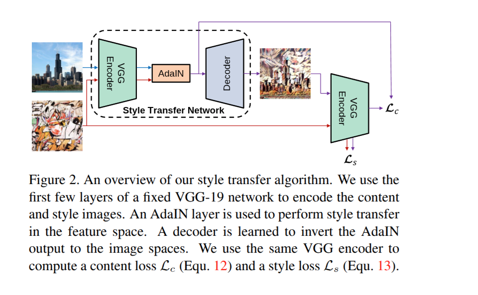

<div align="center">

# 🎨 Arbitrary Neural Style Transfer (AdaIN)

[](https://www.python.org/downloads/)
[](https://pytorch.org/)
[](https://flask.palletsprojects.com/)
[](https://opensource.org/licenses/MIT)

**Transform any image into a masterpiece in real-time using Deep Learning.**

[Features](#-features) • [Architecture](#-architecture) • [Installation](#%EF%B8%8F-installation) • [Usage](#-usage) • [Gallery](#%EF%B8%8F-gallery)

</div>

---

## 📖 Overview

This repository features an end-to-end Deep Learning pipeline for **Arbitrary Neural Style Transfer**. Unlike standard style transfer models trained on a single painting, this project utilizes **Adaptive Instance Normalization (AdaIN)** to blend *any* content image with *any* style image instantly, without needing to retrain the network.

The project includes everything from custom dataset training scripts and exploratory notebooks to a fully functional, deployable web application.

## ✨ Features

* **⚡ Real-Time Arbitrary Stylization:** Apply any style to any image in a single forward pass.
* **🌐 Interactive Web Interface:** A user-friendly web app (served via `app.py` and `templates/`) to easily upload images and generate art.
* **🧠 Custom Training Pipeline:** Train your own encoder-decoder network from scratch using `train.py`.
* **☁️ Cloud Ready:** Pre-configured with a `Procfile.txt` for seamless deployment to platforms like Heroku or Render.

## 🏗️ Architecture

The model is built on the AdaIN architecture, which aligns the channel-wise mean and variance of the content feature maps to match those of the style feature maps. 


*(Reference diagram of the AdaIN algorithm)*

## 📂 Repository Structure

```text
📦 ai-nst-project
 ┣ 📂 Demo_IO_Images     # Sample content, style, and generated output images
 ┣ 📂 content_data       # Training dataset directory for content images
 ┣ 📂 style_data         # Training dataset directory for style images
 ┣ 📂 templates          # HTML files for the web application UI
 ┣ 📂 uploads            # Temp storage for user-uploaded images during inference
 ┣ 📂 utils              # Helper functions (preprocessing, loss functions, etc.)
 ┣ 📜 Procfile.txt       # Deployment configuration file
 ┣ 📜 README.md          # Project documentation
 ┣ 📜 adain_algo.png     # Architecture diagram
 ┣ 📜 app.py             # Main web application and inference script
 ┣ 📜 code.ipynb         # Jupyter Notebook with EDA and experiments
 ┣ 📜 requirements.txt   # Python dependencies
 ┗ 📜 train.py           # PyTorch model training script
```

## ⚙️ Installation

1. **Clone the repository:**
   ```bash
   git clone https://github.com/vaishnavig8276/ai-nst-project.git
   cd ai-nst-project
   ```

2. **Create a virtual environment (Recommended):**
   ```bash
   python -m venv venv
   source venv/bin/activate  # On Windows use: venv\Scripts\activate
   ```

3. **Install dependencies:**
   ```bash
   pip install -r requirements.txt
   ```

## 🚀 Usage

### Running the Web App
To launch the web interface locally and start creating art:
```bash
python app.py
```
*The app will typically be available at `http://localhost:5000` (or the port specified in your console).*

### Training the Model
To train the model on your own datasets, place your images in `content_data/` and `style_data/`, then run:
```bash
python train.py
```
*(Check `train.py` for configurable hyper-parameters like batch size, learning rate, and epochs).*

## 🖼️ Gallery

*(Replace the paths below with your actual demo images to show off your model's capabilities!)*

| Content Image | Style Image | Output Image |
| :---: | :---: | :---: |
|  |  |  |
|  |  |  |

## 📚 Acknowledgments
* **Original Paper:** [Arbitrary Style Transfer in Real-time with Adaptive Instance Normalization (Huang & Belongie, 2017)](https://arxiv.org/abs/1703.06868)
* Developed by [Vaishnavi Gupta](https://github.com/vaishnavig8276).

---
<div align="center">
  <i>If you find this project helpful, please consider giving it a ⭐!</i>
</div>